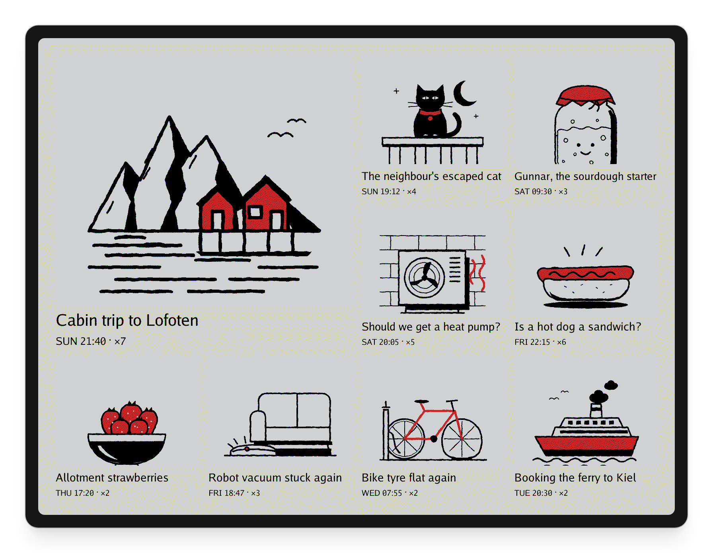

# E-maki

A picture frame that listens to the room and paints what you talk about, as a collage on a colour e-ink panel.

<p align="center">
  
  <br>
  <em>An example page, laid out and dithered by E-maki for a 13.3" Spectra 6 panel. The topics are made up.</em>
</p>

<p align="center">
  <a href="https://github.com/Strandgaard96/E-maki/actions/workflows/ci.yml"></a>
  <a href="#license"></a>
  <a href="go.mod"></a>
  <a href="#built-with-claude-code"></a>
</p>

> [!WARNING]
> Early and experimental. Expect rough edges and breaking changes.

## Built with Claude Code

> [!WARNING]
> The project is vibe-coded and should be treated as such.

Claude Code wrote most of the code. I steered the design and make architecture and tool decisions. The guidelines it works under are in [CLAUDE.md](./CLAUDE.md), including the privacy rules every change has to follow.

## Inspiration

I was heavily inspired by the amazing [Fugleramme](https://github.com/arnegiacomo/fugleramme) project: an e-ink frame that shows a collage of the birds [BirdNET-Go](https://github.com/tphakala/birdnet-go) hears in the garden. I wanted the same idea for conversation topics: a dynamic frame that slowly updates with generated images of conversation topics.

### The name

An emaki (絵巻) is a Japanese illustrated handscroll that tells a story in pictures as you unroll it, and *e* (絵) in Japanese can also mean picture. Thus, E-maki.

## How it works

1. **Listen.** A mic records the room in segments. Audio stays in memory and is never saved.
2. **Transcribe.** [whisper.cpp](https://github.com/ggml-org/whisper.cpp) transcribes each segment into text.
3. **Spot the topic.** About once a minute a local LLM in [Ollama](https://github.com/ollama/ollama) reads the last few minutes and infers the topic.
4. **Paint it.** A new topic becomes a short image prompt, which is sent to an image API. This could be a local image provider with [stable-diffusion.cpp](https://github.com/leejet/stable-diffusion.cpp), or a remote AI image provider.
5. **Display.** The image is fetched by the E-ink driver and displayed. How images are displayed is customized in the E-maki webserver.

## Privacy

E-maki is an always-on microphone.

- Audio and transcripts stay in memory. They are never saved or logged.
- Speech-to-text and the topic model run on your machine.
- Only the short English image prompt leaves your network, and only if you use an image API.
- Sensitive topics (health, money, relationships, work) are blocked by default.
- An external topic model is off by default. Turned on, it sends the last few minutes of transcript to that service.
- Anyone on your network can open the page. Set a password under System > Security.

Tell people in the room that it listens. Details in [PRIVACY.md](PRIVACY.md).

## Build one

| Part | What to use |
| --- | --- |
| Computer | Linux with Docker. An integrated GPU makes speech-to-text faster |
| Mic | Any USB or built-in mic |
| Pictures | A Gemini, OpenAI or OpenRouter key, or a local model. Without one you get placeholder tiles |
| Screen | A 13.3" Spectra 6 e-ink panel ([Inky Impression](https://shop.pimoroni.com/products/inky-impression)) on a Raspberry Pi, or an ESP32 board |

The frame runs [Fugleramme's clients](https://github.com/fugleramme/clients), for example [XIAO EE02](https://github.com/fugleramme/clients/tree/main/xiao-arduino). Parts and wiring: [Hardware](docs/hardware.md). Pi setup: [Put it on a frame](docs/setup.md#4-put-it-on-a-frame).

## Install

```bash
mkdir e-maki && cd e-maki
curl -fsSLO https://raw.githubusercontent.com/Strandgaard96/E-maki/main/docker-compose.yml
curl -fsSL -o .env https://raw.githubusercontent.com/Strandgaard96/E-maki/main/.env.example
docker compose up -d
```

Open <http://localhost:8090/> and talk for a minute. The first start downloads the models and takes a while.

For real pictures, add `GEMINI_API_KEY` to `.env`.

| Container | Runs |
| --- | --- |
| `emaki` | Always |
| `whisper` | Always |
| `ollama` | Unless `TOPIC_MODEL=external` |
| `imagegen` | With `LOCAL_IMAGES=1` |

## Configure

- Settings page (port 8090): the frame, listening, topics, privacy and pictures.
- `.env`: API keys, models, `GPU` and the mic. Run `docker compose up -d` after a change.

More in [Setup](docs/setup.md).

## Development

Needs Go (see [go.mod](go.mod)) and gcc.

```bash
go run ./cmd/emaki -script testdata/party.txt         # offline, fake models
go run ./cmd/emaki -config configs/laptop.json -mic   # whisper on :8081, Ollama on :11434
```

To run your checkout in Docker, set `EMAKI_BUILD=1` and run `docker compose up -d --build`.

## Contributing

- Bugs: [open an issue](https://github.com/Strandgaard96/E-maki/issues/new/choose)
- Questions and builds: [Discussions](https://github.com/Strandgaard96/E-maki/discussions)
- Fixes: open a PR with a [conventional commit](https://www.conventionalcommits.org/) title
- Security: see [SECURITY.md](SECURITY.md)

Read [CONTRIBUTING.md](CONTRIBUTING.md) first.

## Credits

- [Fugleramme](https://github.com/arnegiacomo/fugleramme) by Arne Giacomo Munthe-Kaas. Its dithering, `.e6` format and panel protocol are ported to Go.
- [BirdNET-Go](https://github.com/tphakala/birdnet-go) by tphakala.

## License

- Code: MIT. See [`LICENSE`](LICENSE).
- Settings page: [Preact](https://preactjs.com), [Tailwind CSS](https://tailwindcss.com), [Basecoat](https://basecoatui.com), [justified-layout](https://github.com/flickr/justified-layout), [PhotoSwipe](https://photoswipe.com). All MIT.
- Code ported from Fugleramme (`internal/panel`): MIT, Copyright (c) 2026 Arne Giacomo Munthe-Kaas. See [`third_party/fugleramme/LICENSE`](third_party/fugleramme/LICENSE).
- [whisper.cpp](https://github.com/ggml-org/whisper.cpp), [Ollama](https://github.com/ollama/ollama), [stable-diffusion.cpp](https://github.com/leejet/stable-diffusion.cpp): MIT, run as separate containers.
- Models: downloaded on first start, under their own licences.
- Generated images: under your image provider's terms or the model's licence.
